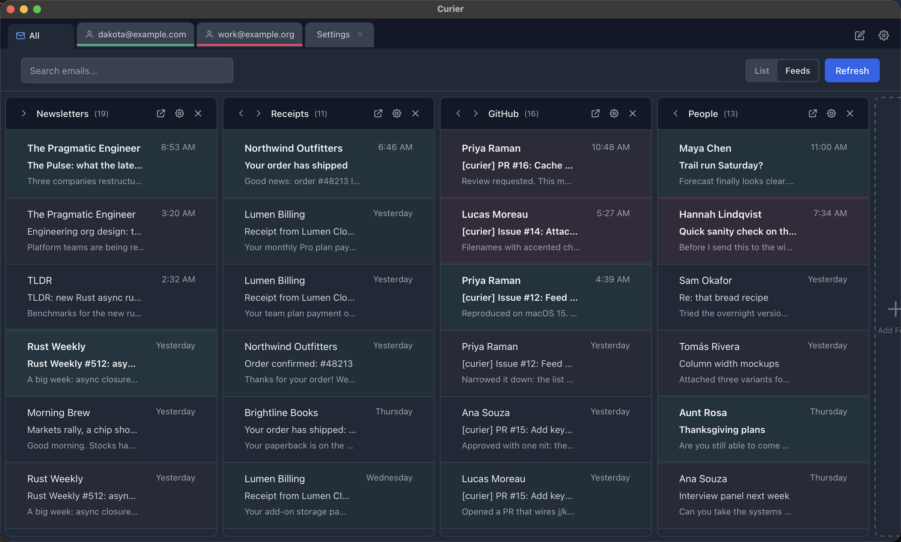

<p align="center">
  
</p>

<p align="center">
  A fast, lightweight, open-source email client built with Tauri and Rust.
</p>

<p align="center">
  Multi-account &nbsp;·&nbsp; Modern UI &nbsp;·&nbsp; Native performance
</p>

---
## Foreword
Like many other builders, I've spent an exorbitant amount of time learning and playing with AI tools over the past couple of years. Personally I noticed a significant shift in the capabilities of these tools after attending last years Re:Invent conference. Prior to that I'd been using Cursor and was operating mostly in an "augmented developer" mode. Which at the time was great. But coming back after the holidays, I started to segway more into claude code and agentic engineering, and it became apparent to me that there where limits that needed to be tested. So this project is the result of me, testing those limits. 

This project originated from me attempting to vibe-code an email app from scratch, in an ecosystem I didn't know. Looking through my prior projects, it's pretty easy to see that my specialty lies mostly on the web. Not in native app development. A tauri app with a react/tailwind ui over the top is where I landed. Even to this day after months of usage, I can confidently say I don't know rust and I haven't written a line of code in here.

I daily drive this app for my personal emails and I stand by it for what it is. A vibe-coded app. It has lots of worts and design choices that others would scoff at. But I would whole-heartedly say that it's improved my digital well-being. It provides an interface that makes it easy to quickly parse my emails as if they were a social media feed, along with some simple tooling for replying to emails where need-be. 

I've waited this long because I've been unsure wether or not anyone would be interested in a project like this. And because I'm not sure how I feel releasing a code base that I didn't author. But I think this is a part of our collective future, the industrialization of software. meaning not every line of every piece of software needs to be handcrafted anymore. So if you're like me and you want a "lightweight" native app to parse your emails in a more sane format beyond a chronological feed, this is for you. If you're looking for an enterprise-grade email client with fancy features and reliability of a thousand on-call devs, this is not the product for you.

If anyone does see this, I am still using it lol. If you'd like to request changes or include changes of your own all the traditional knobs and levers are open. Considering this is made from the crunched up dust of the Library of Alexandria, it only makes sense for me to turn it back out into the world right?

- Dakota

## Why Curier?

Most modern email clients are built on Electron and consume 300–500MB of RAM just to show your inbox. Native clients like Apple Mail are lighter, but locked to one platform with limited flexibility.

Curier takes a different approach: a **Rust backend** for speed and safety, a **React frontend** for a modern UI, and **Tauri** to bridge them — all in a package that uses a fraction of the memory.


## Features

- **Lightweight**
- **Multi-account** — manage multiple Gmail accounts from a single window
- **Tabbed interface** — open emails, compose windows, and account views in tabs
- **Feeds view** — browse newsletters and subscriptions in a dedicated feed layout
- **Fast search** — search across your inbox quickly
- **Dark theme** — easy on the eyes, built-in
- **Secure auth** — OAuth2 PKCE flow with credentials stored in the macOS Keychain
- **HTML email rendering** — sanitized with `ammonia` for safe viewing
- **SQLite storage** — local email cache for fast offline browsing

## Screenshot

<p align="center">
  
  <br />
  <em>The feeds view, captured from demo mode</em>
</p>

## Tech Stack

- **Backend:** Rust (Tauri 2.x)
- **Frontend:** React 19, TypeScript, Tailwind CSS, Vite
- **Email:** Gmail REST API with OAuth2 PKCE
- **Storage:** SQLite via `rusqlite`
- **Security:** HTML sanitization via `ammonia`, credentials in macOS Keychain

## Getting Started

### Prerequisites

- [Node.js](https://nodejs.org/) 20.19+ or 22.12+
- [Rust](https://rustup.rs/) (via `rustup`)
- A Google Cloud project with Gmail API enabled and OAuth2 Desktop credentials

### Setup

```bash
# Clone the repo
git clone https://github.com/IamFlowZ/curier.git
cd curier

# Install frontend dependencies
npm install

# Run the development build
npm run tauri dev
```

On first launch, you'll be prompted to enter your Google OAuth Client ID and Client Secret. Curier then opens your browser to Google's consent screen; once you approve, the account is added automatically (you never type your Gmail address into Curier).

### Demo mode

To try Curier without a Google account, or to take screenshots, launch it with `CURIER_DEMO_DATA=1`: the app boots with two fake accounts and a deterministic set of synthetic emails, tags, rules and feeds, and never performs OAuth or touches the network. Demo data lives in a separate `demo/` subdirectory of the app data folder, so your real mailbox cache and settings are left untouched.

```bash
CURIER_DEMO_DATA=1 npm run tauri dev
```

### Google Cloud Setup

1. Go to the [Google Cloud Console](https://console.cloud.google.com/)
2. Create a new project (or use an existing one)
3. Enable the **Gmail API**
4. Go to **Credentials** → **Create Credentials** → **OAuth 2.0 Client ID**
5. Select **Desktop application** as the type
6. Copy the Client ID and Client Secret into Curier's login screen

### Building for Production

```bash
npm run tauri build
```

This produces a native macOS `.dmg` in `src-tauri/target/release/bundle/`.

### Installing a build on another Mac

Builds are ad-hoc signed, not notarized (that requires a paid Apple developer account). When you copy the app to another Mac, macOS marks it as downloaded and Gatekeeper reports it as "damaged." The app is fine; clear the quarantine flag after copying it into Applications:

```bash
xattr -dr com.apple.quarantine /Applications/Curier.app
```

Alternatively, launch once, then open System Settings → Privacy & Security and click **Open Anyway**.

## Architecture

```
curier/
├── src/                    # React frontend
│   ├── components/         # UI components
│   ├── features/           # Feature modules (auth, email, feeds, tabs, etc.)
│   ├── hooks/              # Custom React hooks
│   ├── store/              # Zustand state management
│   └── App.tsx             # Root component
├── src-tauri/              # Rust backend
│   └── src/
│       ├── commands/       # Tauri IPC commands (auth, email, system)
│       ├── models/         # Data models (auth tokens, email types)
│       ├── services/       # Core services (Gmail API, OAuth, SQLite, memory)
│       └── lib.rs          # App setup and command registration
```

## Roadmap

- [ ] Outlook / Microsoft 365 support (in progress)
- [ ] Linux builds
- [ ] Keyboard shortcuts
- [ ] Notifications
- [ ] Attachment handling improvements
- [ ] Contact autocomplete
- [ ] Email rules / filtering engine (in progress)
- [ ] Encrypted local storage
- [ ] Plugin system

## Contributing

Issues and pull requests are welcome. There is no formal process: open an issue describing the problem, or send a PR with a short explanation of the change.

## License

[MIT](LICENSE)

---

<p align="center">
  Built with <a href="https://v2.tauri.app">Tauri</a>, <a href="https://www.rust-lang.org">Rust</a>, and <a href="https://react.dev">React</a>.
</p>
